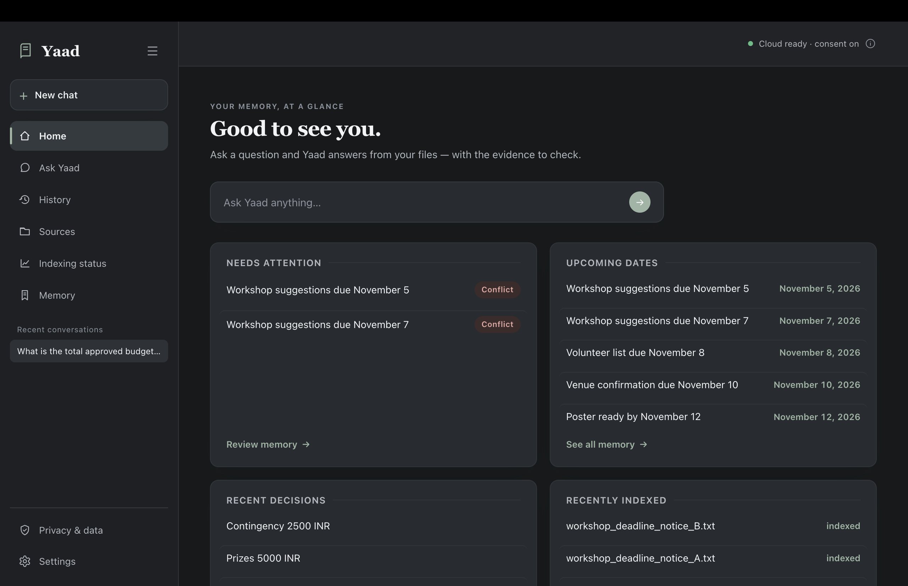
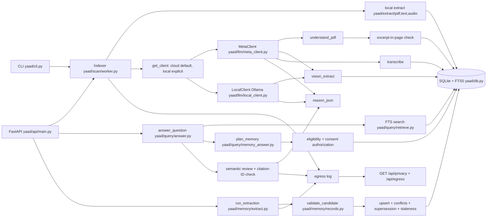
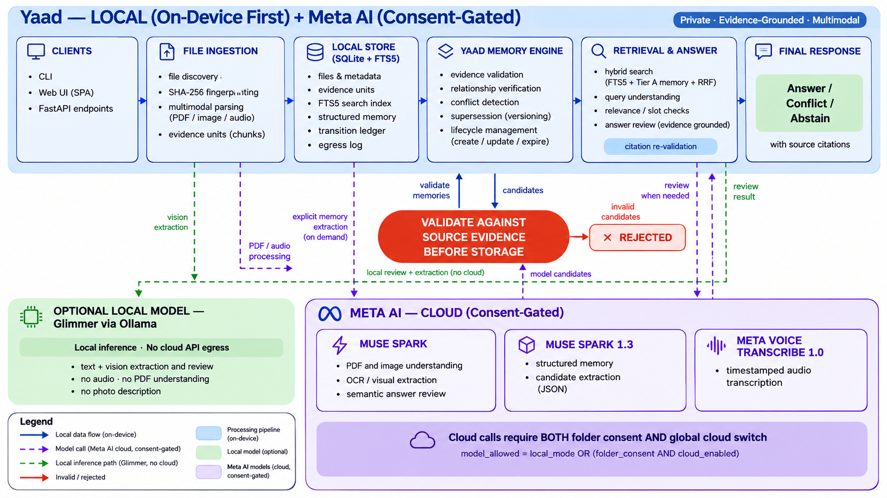
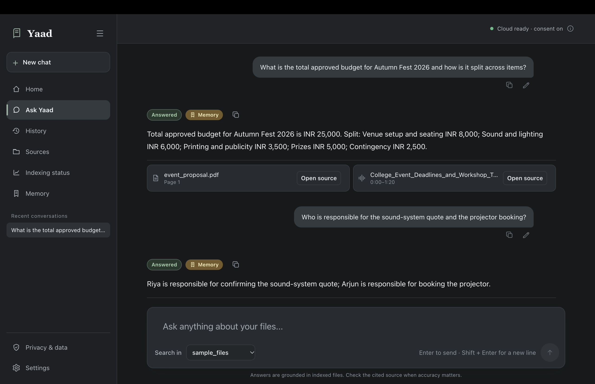
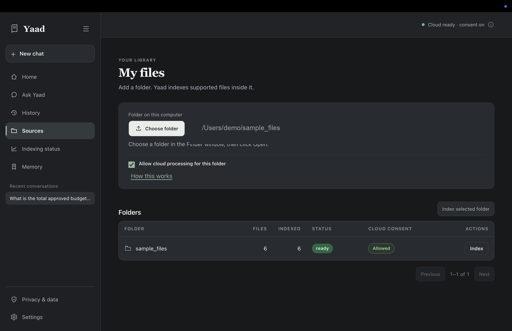
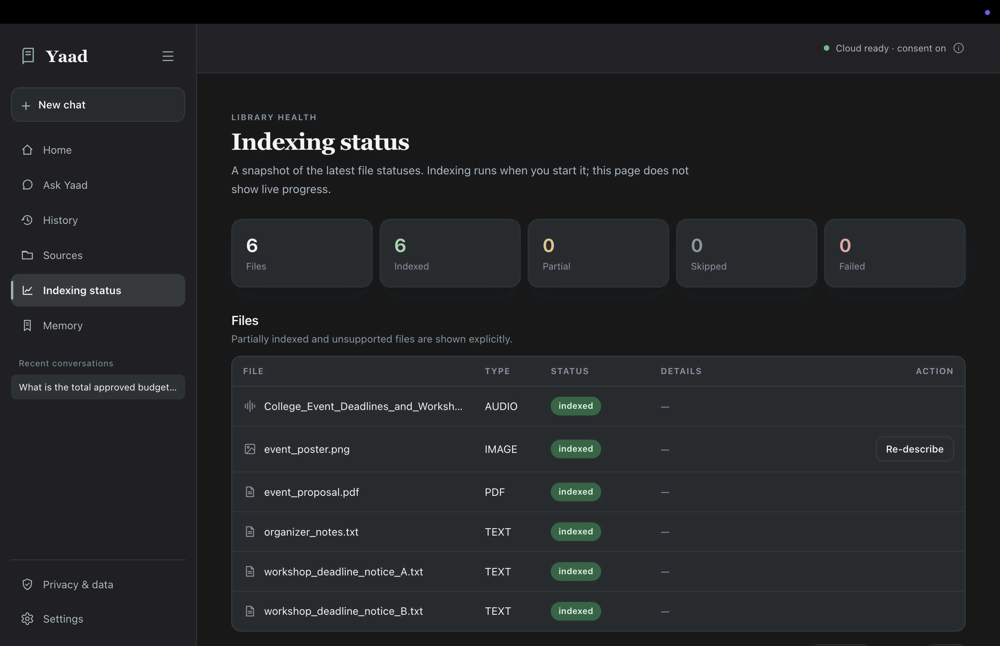
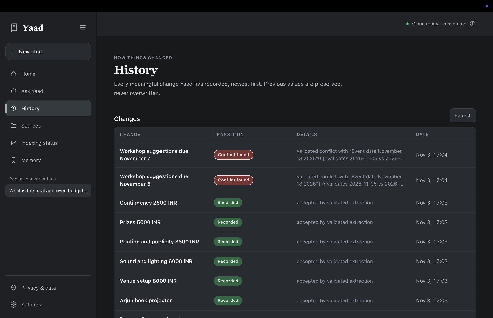

# Yaad (याद) — Local-first, evidence-backed personal memory

**Yaad turns your scattered files into a memory you can question — and every answer carries its proof.**

Yaad indexes folders you explicitly add — PDFs, text documents, images, and audio — then builds a persistent, structured memory of the decisions, deadlines, commitments, and open questions inside them. Ask in plain language over the CLI, API, or web UI and Yaad answers from that memory, reasons across files, tracks how facts change over time, flags conflicts with both sides cited, and abstains honestly when the evidence is not there.

Built from scratch during the **Meta Global AI Developer Hackathon 2026** (*Build for Your World*, October 27–November 4, 2026).

## Demo

> Demo video (3 min): [https://youtu.be/4haKXzfsi_g](https://youtu.be/4haKXzfsi_g) — walkthrough outline: `docs/SUBMISSION_EVIDENCE.md` §6.
>
> [View the Yaad Pitch Deck](YAAD_pitch_deck.pdf)



*Home view — conflicts needing attention, upcoming dates, recent decisions, and recently indexed files, all linked to sources.*

## The problem

Personal information is scattered across PDFs, documents, images, screenshots, and voice memos. Finding one detail means reopening files; connecting facts across files means holding everything in your head; and when a date moves or two files disagree, the old truth is silently lost. Chatbots don't help — they read at ask-time and forget, and basic retrieval returns text chunks with no notion of what is currently true.

## The solution

Yaad is a personal memory engine, not a chatbot:

- **Extract once, remember durably.** Decisions, deadlines, commitments, and open questions become structured records in SQLite, each wired to the exact excerpts it came from.
- **Reason across files and modalities.** Hybrid retrieval (FTS5 keywords + memory channel, fused with Reciprocal Rank Fusion) corroborates values across documents, images, and transcripts.
- **Track time, preserve history.** Supersession links record replacements; previous values stay inspectable in a transition ledger — never silently overwritten.
- **Disagree honestly.** Conflicting values are preserved with both sides cited, and are never served as settled facts. Weak evidence yields a clean abstention, not a guess.

Guiding principle: **Models Propose. Evidence Disposes.** AI models assist with understanding and extraction, while deterministic validation, provenance tracking, relationship checks, and evidence verification have the final word.

## Impact

Everyone has information. Finding it when needed is the challenge.

Regardless of our profession, background, or daily activities, we accumulate information across documents, PDFs, images, screenshots, emails, and recordings. Over time, remembering where something was stored, connecting related details, and knowing whether information is still relevant becomes increasingly difficult.

Yaad addresses this universal challenge by transforming scattered digital files into persistent, searchable, and connected personal memory.

Its impact goes beyond document search:

* Save time: Retrieve information without manually searching through multiple files.
* Preserve context: Retain important decisions, deadlines, commitments, and past information.
* Make informed decisions: Connect information across sources and identify conflicting or outdated details.
* Build trust: Verify answers through references to original evidence.
* Avoid forgotten details: Keep important information and unresolved questions accessible.

### Impact across everyday life

Yaad can support students managing academic records, professionals handling projects, families organizing personal documents, entrepreneurs tracking decisions, and individuals preserving information from everyday experiences. These are examples of a broader purpose: making accumulated digital information useful regardless of how or where it was created.

### Early validation and vision

Feedback from two users provided encouraging informal observations. Both found Yaad useful for everyday information retrieval. One appreciated evidence-backed answers, while the other suggested making important deadlines more prominent. This is preliminary feedback, not a formal usability study.

Our vision is simple: make personal information as accessible as asking a question. Instead of letting valuable information disappear into folders and forgotten files, Yaad aims to help people retrieve, connect, and reuse what they already know.

Broader user validation and measured time savings remain important next steps.

## Hackathon Contributions — What We Built

Yaad was designed and built from scratch during the hackathon window (October 27–November 4, 2026): the full application architecture and every end-to-end workflow below are original hackathon implementation — CLI, API, and web UI (`yaad/cli.py`, `yaad/api/main.py`, `yaad/ui/`), scan/index pipeline (`yaad/scan/`), extractors (`yaad/extract/`), memory engine (`yaad/memory/`), query pipeline (`yaad/query/`), LLM boundary (`yaad/llm/`), privacy controls (`yaad/privacy/`), SQLite storage (`yaad/db.py`), the 900+ test suite (`tests/`), evaluations (`eval/`), sample fixtures (`sample_files/`), and documentation (`docs/`, including design records dated Oct 29–31). Technical contributions:

- **Application architecture and end-to-end workflows** — local-first pipeline from folder add through indexing, memory formation, retrieval, and cited answers, served identically over CLI, HTTP API, and a dependency-free web UI.
- **Multimodal file ingestion and content extraction** — PDF text layer plus scanned-page OCR, TXT, DOCX, image understanding, and timestamped audio transcription, with SHA-256 fingerprinting, incremental re-index, and explicit per-file statuses (`indexed` / `partial` / `skipped` / `failed`).
- **Structured, persistent memory and identity-aware retrieval** — validated decision/deadline/commitment/open-question records with evidence links, lifecycle states, and serving verdicts (`yaad/memory/`); Tier A memory channel fused with FTS5 keyword search via Reciprocal Rank Fusion (`yaad/query/hybrid.py`).
- **Cross-file question answering with source citations** — corroboration across documents and modalities, stable `ev_*` evidence IDs, and openable source previews; answers name every source they rely on.
- **Temporal updates, supersession, and conflict detection** — validated supersession links, an append-only transition ledger with staleness marking and inspectable History view (`yaad/memory/ledger.py`, `/api/memory/transitions`); rival values preserved with both sides cited, never served as settled facts.
- **Evidence verification and honest abstention** — deterministic relationship validation, claim-level checks (citation existence, excerpt containment, numeric/date consistency, chronology), and a staged answer pipeline that returns `not_found`/`unverified` instead of guessing (`yaad/memory/relationships.py`, `yaad/query/verify.py`, `pipeline.py`).
- **Privacy, consent, egress, and spend safeguards** — per-folder consent AND a global cloud kill-switch on every external call, per-stage spend ceilings, identifier redaction on cloud-bound payloads, prompt-injection quarantine, and a per-attempt egress receipt log surfaced in Privacy views.
- **Meta model integrations** — Muse Spark 1.3 (default) for PDF/image understanding, structured memory-candidate extraction, link verification, joint two-image comparison, and answer review; Meta Voice Transcribe 1.0 for all audio transcription. Every model output is schema-validated and evidence-checked by deterministic code that keeps final authority ("Models Propose. Evidence Disposes."). The Ollama/Glimmer local path is implemented but experimental with real-weight quality unverified; Spark 1.2/1.1 and Wonder are allowlisted only. Yaad is a staged retrieval-and-verification pipeline, not an autonomous multi-agent system.
- **Evaluation and demo** — 900+ test suite, frozen 72-case benchmark, real-model eval series with preserved receipts, Meta capability suite, sample fixtures, video walkthrough, and pitch deck.

## Key features

| Area | What Yaad does |
|---|---|
| Multimodal ingestion | PDF (text layer + scanned-page OCR), TXT, DOCX, images with visible-text extraction, audio transcription; SHA-256 fingerprinting, incremental re-index, explicit per-file statuses (`indexed` / `partial` / `skipped` / `failed`) |
| Structured memory | Record types `decision`, `deadline`, `commitment`, `open_question`; lifecycle statuses (`decided`, `open`, `conflicted`, `superseded`, `stale`); serving verdicts keep unsettled records out of factual answers |
| Temporal reasoning | Validated supersession links, transition ledger, staleness marking; "what changed and why" stays answerable |
| Conflict handling | Unit- and memory-level rival detection (dates, amounts, validated textual rivalry); conflicts cite both values |
| Answers with proof | Tiered claim relevance, slot checks, independent verification (citation existence, excerpt containment, numeric/date consistency, chronology); statuses `answered`, `conflict`, `ambiguous`, `partial`, `not_found`, `unverified` |
| Conversation learning | Statements in chat can teach durable facts via background extraction; recent conversations persist in the UI |
| Trust & privacy | Local-first SQLite storage; per-folder consent AND global cloud switch for every external call; per-stage spend caps; identifier redaction on cloud-bound payloads; prompt-injection quarantine; full egress receipt log |
| Interfaces | Typer CLI, FastAPI backend, dependency-free single-page web UI (Home, Ask, History, Sources, Indexing status, Memory, Privacy & data, Settings) |

## How it works



Data flow: folders enter only through explicit add; every cloud call passes folder consent plus the global kill-switch; every stored fact keeps the evidence IDs and excerpts it came from; conflicts and replacements are resolved by deterministic rules; answers cite evidence or abstain.



*Local pipeline, validation gate, and consent-gated model boundary. Details: [docs/ARCHITECTURE.md](docs/ARCHITECTURE.md). An editable programmatic variant can be rendered with `python scripts/make_architecture_horizontal.py`.*

## Meta AI integration

Meta models are called only where they earn their place — understanding, extraction, and review — and every output is schema-validated and evidence-checked by deterministic code.

| Model | Status | What it contributes |
|---|---|---|
| Muse Spark 1.3 (default `YAAD_MODEL`) | **Used** — all cloud text/vision calls, live evals, and receipts | PDF and image understanding, scanned-page OCR / visual extraction, structured memory-candidate extraction (strict JSON), photo comparison, semantic answer review |
| Meta Voice Transcribe 1.0 | **Used** — all audio transcription | Timestamped transcripts for voice memos |
| Muse Glimmer via Ollama (optional local mode) | **Implemented, experimental** when `YAAD_MODEL_PROVIDER=local` | Text + vision extraction and answer review on-device with zero cloud egress; no audio transcription, no PDF document understanding, no photo description; real-weight quality unverified |
| Muse Spark 1.2 / 1.1, Muse Wonder 1.0 | Allowlisted only (selectable via `YAAD_MODEL`; not exercised in evals or receipts) | Same text/vision call sites as 1.3 |

What runs with no model at all: file parsing, keyword and hybrid retrieval, conflict and supersession rules, relationship validation, relevance tiers, citation verification, and all storage. The synthetic capability suite (`scripts/meta_capability_suite.py`) records request metadata, latency, usage, and cost for the Meta contract paths in `docs/capabilities.md`.

## Technology stack

Python 3.11+, FastAPI + Uvicorn, SQLite + FTS5, Pydantic, httpx, Typer, PyMuPDF, Pillow, python-docx. Web UI is dependency-free HTML/CSS/vanilla JS served by the API. Optional: Ollama runtime for local inference; `fastembed` + `numpy` (`[semantic]` extra) for the opt-in embedding channel, off by default.

## Quickstart

Prerequisites: Python 3.11+. For audio files, `ffmpeg` on `PATH`. For cloud features, a Meta Model API key.

```sh
python -m venv .venv
source .venv/bin/activate
pip install -e ".[dev]"     # runtime + test tooling
cp .env.example .env        # then edit: MODEL_API_KEY, YAAD_CLOUD_ENABLED=true for cloud use

yaad add-folder sample_files --cloud-consent   # consent only matters when cloud is enabled
yaad index
yaad ask "What is the registration fee?"
yaad serve   # open http://127.0.0.1:8000
```

Security note: .env holds your Meta API key and is gitignored. Never commit it, zip it, or share it. To share the project, share the repository (git clone) rather than the working folder. If a key is ever exposed, rotate it immediately. You can also skip the file and set MODEL_API_KEY in your shell environment instead.

The `sample_files/` demo fixtures (event proposal, poster, organizer notes, workshop notices, and a synthetic AI-generated voice note on deadlines and workshop topics, approved for publication) index end-to-end so you can try Ask, Memory, History, and Privacy views immediately. Cloud consent defaults off per folder; consented PDFs, scanned page images, images, audio, and question-relevant excerpts may be sent to Meta when `YAAD_CLOUD_ENABLED=true`. TXT and DOCX are always indexed locally. The database defaults to `~/.yaad/yaad.sqlite3`; originals are never copied into it. To recover the search index: `yaad rebuild-fts`.

Without a MODEL_API_KEY (or with YAAD_CLOUD_ENABLED=false), indexing still runs locally, but some PDF and image files are indexed as partial, and Ask returns cited keyword evidence instead of synthesized memory answers. Memory records and conflict verdicts need cloud or local-model extraction.

Local inference (experimental): install Ollama, `ollama pull muse-glimmer:30b`, set `YAAD_MODEL_PROVIDER=local` in `.env`, restart. Local mode fails closed and never falls back to cloud. Full guide and limits: [docs/LOCAL_INFERENCE.md](docs/LOCAL_INFERENCE.md).

## Configuration

All settings are environment variables (see `.env.example` and `yaad/config.py`); `MODEL_API_KEY` and cloud enablement are the only ones most users touch.

| Variable | Default | Purpose |
|---|---|---|
| `MODEL_API_KEY` | — | Meta Model API key for cloud calls |
| `YAAD_CLOUD_ENABLED` | `false` | Global kill-switch; every cloud call also needs per-folder consent |
| `YAAD_MODEL` | `muse-spark-1.3` | Text/vision model for cloud calls (allowlisted set) |
| `YAAD_DB_PATH` | `~/.yaad/yaad.sqlite3` | SQLite database location |
| `YAAD_MODEL_PROVIDER` | `cloud` | `cloud` (Meta API) or `local` (Ollama runtime) |
| `YAAD_LOCAL_ENDPOINT` / `YAAD_LOCAL_MODEL` | `http://localhost:11434` / `muse-glimmer:30b` | Local runtime base URL and model tag |
| `YAAD_REVIEW_MAX_SPEND_USD` / `YAAD_PIPELINE_STAGE_MAX_SPEND_USD` | `0.05` / `0.05` | Per-answer and per-stage model spend ceilings |
| `YAAD_VERIFY_MODEL_VOTES` | `1` | Model votes per claim in entailment verification |
| `YAAD_INDEX_MAX_SPEND_USD` / `YAAD_CLOUD_SPEND_CAP_USD` | `0` / `0` | Indexing and global caps (`0` disables) |
| `YAAD_AUTO_MEMORY` | `true` | Background learning after indexing/answering (never blocks responses) |
| `YAAD_SEMANTIC_RETRIEVAL` | `false` | Opt-in embedding channel; needs `[semantic]` extra |
| `YAAD_MAX_SCANNED_PDF_PAGES` / `YAAD_AUDIO_MAX_MINUTES` | `30` / `10` | Per-file OCR page and audio duration caps |
| `YAAD_API_TOKEN` | — | Required to `serve` on a non-loopback host; then `/api/*` needs `Authorization: Bearer <token>` |

## Usage

CLI (`yaad --help` for all options):

```sh
yaad add-folder /path/to/files [--cloud-consent]
yaad index [FOLDER_ID]
yaad ask "Which budget items changed after the meeting?" [--folder-id ID]
yaad serve [--host 127.0.0.1] [--port 8000]
yaad rebuild-fts
```

Web UI (`yaad serve`, then http://127.0.0.1:8000): Home gives memory at a glance; Ask Yaad answers with inspectable evidence; Memory lists records with serving verdicts; History shows the transition ledger; Sources and Indexing status manage folders and file states; Privacy & data shows the model configuration and every recorded model request with purpose, status, and cost.

HTTP API: folders, consent, indexing, ask, memory, evidence previews, photos, feedback, privacy, and egress endpoints — see [docs/API.md](docs/API.md).

## Screenshots



*Ask Yaad — answered from memory, with PDF and timestamped audio sources cited.*



*Sources — folder picker with per-folder cloud consent and folder health.*



*Indexing status — all six sample files indexed across four modalities.*



*History — transition ledger preserving recorded facts and detected conflicts.*

## Testing and evaluation

```sh
pip install -e ".[dev]"
# Generate gitignored test fixtures first (fresh clones only; refuse to overwrite):
python scripts/make_capability_fixtures.py && python scripts/make_synthetic_data.py
python scripts/make_real_eval_v2_data.py && python scripts/make_real_eval_v3_data.py && python scripts/make_hostel_eval_data.py
python -m pytest tests/ -q        # 896 passed, 5 skipped, 0 failed (macOS, Python 3.11, verified 2026-11-05)
python eval/run_eval.py            # 3/3 retrieval, 1/1 abstention on synthetic fixtures
node --check yaad/ui/app.js        # UI syntax check
```

The suite runs with no external network calls: Meta interactions use a fake client, and local-mode contract tests use a loopback fake server. tests/conftest.py points YAAD_DB_PATH at a temporary directory, so running the tests never touches your real ~/.yaad database. 5 browser end-to-end tests are skipped unless Playwright browsers are installed (playwright install chromium). In sandboxes that forbid loopback servers, 13 additional local-inference tests are skipped. Byte-exact sample outputs: [docs/EVALUATION_TRACES.md](docs/EVALUATION_TRACES.md) and `docs/traces/`. The `eval/` directory holds the deterministic harness plus real-model evaluations with preserved receipts; the tiny synthetic harness checks contracts on fixtures, not broad accuracy.

## Project structure

```text
yaad/            CLI, FastAPI API, scan/index workers, extractors, LLM clients,
                 memory engine, query pipeline, privacy controls, web UI
tests/           pytest suite (fake Meta client; no external network calls)
eval/            deterministic harness + real-model evaluations with receipts
sample_files/    demo fixtures for an end-to-end trial run
scripts/         capability suite, fixture generators, diagram renderers
docs/            guides, architecture, API reference, traces, design records
```

## Documentation

- [Architecture](docs/ARCHITECTURE.md) — system overview, components, data flow, verification story.
- [API reference](docs/API.md) — HTTP endpoints served by `yaad serve`.
- [Local inference](docs/LOCAL_INFERENCE.md) — Ollama + Glimmer setup, capability limits, verification checklist.
- [Capabilities](docs/capabilities.md) — recorded Meta API capability-suite results and how they were measured.
- [Evaluation traces](docs/EVALUATION_TRACES.md) — byte-exact synthetic sample outputs (also `docs/traces/`).
- [Submission evidence](docs/SUBMISSION_EVIDENCE.md) — hackathon demo outline and evidence map.
- [Egress disclosure](docs/EGRESS_DISCLOSURE.md) — what can leave the device and the controls around it.
- Design records (written during the hackathon): [claim relevance](docs/CLAIM_RELEVANCE_DESIGN.md), [hybrid retrieval](docs/HYBRID_RETRIEVAL_DESIGN.md), [temporal ledger](docs/TEMPORAL_MEMORY_LEDGER_DESIGN.md).

## Known limits

- Conflict detection covers date/amount slots plus validated textual rivalry (venue/person/name); bare lowercase values, bare counts, and paraphrase-heavy matching remain documented gaps.
- Retrieval is FTS keyword search plus memory-channel fusion by default; the opt-in semantic channel measured paraphrase R@1 0.125 → 0.875 on n=11 authored fixtures (`eval/paraphrase_recall/`), and real-world quality remains unmeasured.
- The synthetic harness and capability suite check contracts on fixtures, not broad accuracy. Video is unsupported; other unknown formats are recorded as skipped.

## Privacy model

Folders enter only through explicit add. Every external model call requires per-folder consent AND `YAAD_CLOUD_ENABLED=true`, passes per-stage spend ceilings, and is receipted in the egress log (purpose, provider, model, latency, usage, cost). Cloud-bound payloads minimize identifiers; evidence is screened for injection markers and quarantined units are dropped before any model call. Revoking consent immediately removes affected records from serving while preserving inspectable history. Originals stay on-device and authoritative.

## Hackathon

Yaad was built from scratch during the **Meta Global AI Developer Hackathon 2026** (theme: *Build for Your World*, October 27–November 4, 2026). Its core idea: personal files hold decisions that change over time, and an assistant should track those changes with inspectable evidence rather than summarize chunks. Cloud inference uses the Meta Model API; an optional local mode routes supported calls to Meta's open-weight Muse Glimmer under Ollama. Deterministic components (extraction validation, relationship verification, relevance tiers, retrieval fusion) use no model at all. Read the event's Official Rules yourself before submission; this project does not interpret or certify them.

## License

Yaad's own code is MIT licensed — see [LICENSE](LICENSE). Third-party
dependencies retain their own licenses (see [NOTICE](NOTICE)); notably,
the PyMuPDF dependency is dual-licensed AGPL-3.0 or commercial.
