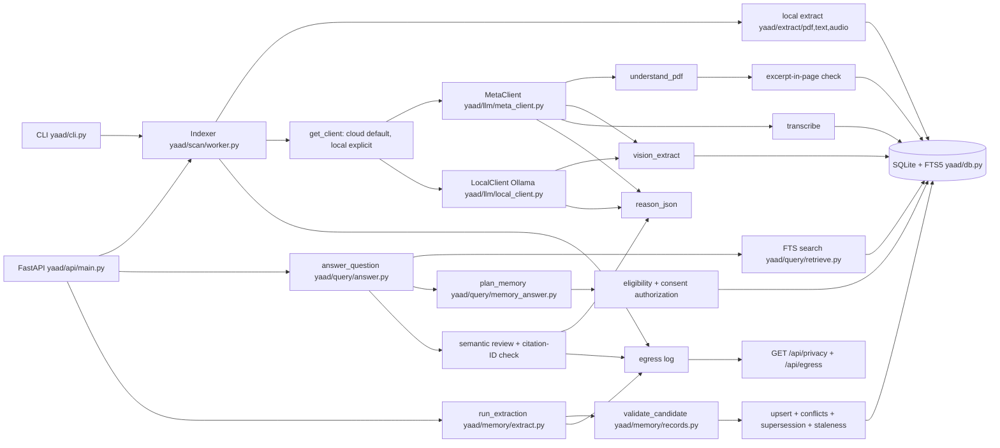

# Yaad

Yaad is a local-first, evidence-backed memory engine for your own files. It indexes only folders you add, extracts decisions, deadlines, and commitments into inspectable memory, and answers with cited sources — or abstains honestly.

**Meta Global AI Developer Hackathon 2026** — Indie Developer track, theme *Build for Your World*. [What was built during the event](#hackathon) — the demo below covers event-period work.

## Why: a problem I know firsthand

My PDFs, photos, and voice notes hold decisions that change: a venue moves, a budget is revised, a deadline slips. Search finds files and chatbots summarize chunks, but neither tracks what is *currently true*, what changed, or when to abstain. Yaad turns those files into evidence-backed memory: ask a question, get an answer, check the source.

## How Meta AI is used

- **Muse Spark (Meta Model API):** memory extraction, image understanding, scanned-page OCR, PDF understanding, and citation-checked semantic answer review.
- **Meta Voice Transcribe:** audio transcription with checked timestamps.
- **Muse Glimmer (local, optional):** the same extraction, review, and vision calls on-device via Ollama; never falls back to cloud.
- **No model:** evidence validation, relationship verification, relevance tiers, retrieval fusion, and the temporal ledger are deterministic code, so factual status is never a model's opinion.

## 30-second verification

No network calls, no API key, no cloud spend.

```sh
pip install -e ".[dev]"
python -m pytest tests/ -q        # 412 passed, 13 skipped, 0 failed here (425 collected; skips are sandbox loopback-bind tests; verified 2026-10-31)
python eval/run_eval.py            # 3/3 retrieval, 1/1 abstention on synthetic fixtures
node --check yaad/ui/app.js       # UI syntax check
```

Byte-exact sample outputs: `docs/EVALUATION_TRACES.md` and `docs/traces/`.

## Demo (2 minutes)

1. `yaad add-folder yaad_cross_file_test && yaad index && yaad serve`, then open http://127.0.0.1:8000.
2. Ask "What is the registration fee?" — the answer cites the exact PDF page and excerpt.
3. Ask about the venue across files — superseded values stay visible as history while the current one wins.
4. Ask something unanswerable — clean `not_found`, no guessing. Privacy & data shows every cloud call.

> Demo video: link will be added here before the Nov 4 submission.

## How it works



Data flow: folders enter only through explicit add; every cloud call passes
folder consent plus the global kill-switch; every stored fact keeps the
evidence IDs and excerpts it came from; conflicts and replacements are
resolved by deterministic rules; answers cite evidence or abstain.

## Feature matrix

### Indexing and storage

| Subsystem | Source files | Tests |
|---|---|---|
| Folder add, discovery, incremental index | `yaad/scan/worker.py` (`Indexer`), `yaad/scan/discover.py` | `tests/test_ingest_limits.py` (6 tests) |
| PDF text, TXT, DOCX extraction | `yaad/extract/pdf.py`, `yaad/extract/text.py` | `tests/test_memory_workflow.py::test_pdf_facts_keep_verified_page_excerpt_and_are_searchable` |
| SQLite + transactional FTS5, rebuild | `yaad/db.py` (`Database`, triggers, `rebuild_fts`) | `tests/test_reliability_fixes.py::test_deleted_files_are_swept_but_egress_history_survives` |
| Size caps and loud truncation | `yaad/scan/worker.py`, `yaad/config.py` | `tests/test_ingest_limits.py` |

### Memory extraction and validation

| Subsystem | Source files | Tests |
|---|---|---|
| Explicit extraction, consent + $0.25 spend-cap gates | `yaad/memory/extract.py` (`run_extraction`) | `tests/test_memory_extract.py` (13 tests) |
| Candidate validation, dedupe, identity keys | `yaad/memory/records.py` (`validate_candidate`, `upsert_records`) | `tests/test_memory_records.py` (17 tests) |
| Stable evidence IDs | `yaad/evidence/ids.py` (`evidence_id`) | `tests/test_memory_records.py::test_schema_applies_and_cascades` |
| API: extract, list, flag | `yaad/api/main.py` (`/api/memory*`) | `tests/test_memory_api.py` (10 tests) |

### Conflicts, supersession, staleness

| Subsystem | Source files | Tests |
|---|---|---|
| Unit-level conflict detection | `yaad/query/answer.py` (`answer_question`) | `tests/test_cross_file_fixes.py` (12 tests) |
| Memory conflicts, amount-aware rivals | `yaad/memory/records.py` (`mark_conflicts`) | `tests/test_memory_amounts.py` (8 tests) |
| Validated supersession links | `yaad/memory/records.py` (`apply_supersession_links`) | `tests/test_memory_supersession.py` (9 tests) |
| Stale marking and evidence preservation | `yaad/memory/records.py` (`mark_stale`) | `tests/test_memory_preservation.py` (7 tests) |

### Answering, retrieval, serving

| Subsystem | Source files | Tests |
|---|---|---|
| Ask pipeline, statuses, fallback | `yaad/query/answer.py` (`answer_question`) | `tests/test_memory_answers.py` (15 tests), `tests/test_memory_e2e.py` (11 tests) |
| FTS retrieval + cross-file corroboration | `yaad/query/retrieve.py` (`search`) | `tests/test_cross_file_fixes.py::test_exact_reported_corroboration_wording_retrieves_other_files` |
| Memory planning, synthesis, status listings | `yaad/query/memory_answer.py` (`plan_memory`, `synthesize`) | `tests/test_memory_status.py` (10 tests) |
| Eligibility and consent authorization | `yaad/memory/records.py`, `yaad/query/memory_answer.py` | `tests/test_memory_serving.py` (9 tests) |
| Consented semantic review, citation-ID check | `yaad/query/answer.py` (`_semantic_review`) | `tests/test_memory_workflow.py::test_semantic_answer_requires_consent_and_rejects_unknown_citations` |
| Photos search and re-description | `yaad/query/photos.py`, `yaad/scan/worker.py` (`redescribe_image`) | `tests/test_api_refinements.py::test_redescription_refuses_unconsented_folder_without_provider_call` |

### Privacy, audit, UI

| Subsystem | Source files | Tests |
|---|---|---|
| Dual consent gates, egress log | `yaad/scan/worker.py`, `yaad/memory/extract.py`, `yaad/config.py` | `tests/test_reliability_fixes.py::test_privacy_reports_disallowed_model_instead_of_500` |
| Privacy and activity endpoints | `yaad/api/main.py` (`/api/privacy`, `/api/egress`) | `tests/test_api_refinements.py::test_privacy_and_egress_pagination_are_independent_and_bounded` |
| Conversation UI, memory views, badges | `yaad/ui/app.js`, `yaad/ui/style.css` | `tests/test_ui_source_regressions.py` (70 tests) |
| Local provider, gates, attribution | `yaad/llm/local_client.py`, `yaad/llm/__init__.py` | `tests/test_local_inference.py` (24 tests) |

## Technical differentiators

1. **Provenance-grounded extraction.** Every memory record stores the
   evidence IDs and excerpts it came from (`yaad/memory/records.py`,
   `validate_candidate`); excerpts must occur in the cited unit text and
   unknown IDs are rejected. Cloud PDF facts must quote the local page
   verbatim (`yaad/scan/worker.py`). IDs are stable hashes over file
   content plus locator (`yaad/evidence/ids.py`).
2. **Deterministic conflict and supersession rules.** Same-matter rivals
   carrying different values (such as ₹150 vs ₹200 registration fees)
   conflict instead of merging, while alias spellings of one amount
   merge; replacement links are structurally validated and
   relatedness-gated before any status changes; conflicted pairs are
   never served as settled facts, even inside partial answers.
3. **Strict consent and egress enforcement.** Every cloud call needs
   per-folder consent AND the global `YAAD_CLOUD_ENABLED` switch; the
   egress log records purpose, provider, model, latency, and usage for
   each call; revoking consent immediately removes records from serving
   while preserving inspectable history.
4. **Layered retrieval and synthesis.** FTS over evidence units, plus
   memory-record injection of corroboration the keyword query missed,
   plus consented model review whose citations are checked against the
   retrieved set. Cross-file questions retrieve across modalities.
5. **Resilient local-first fallback.** With no eligible memory, answers
   use the units-only path unchanged; when review is unavailable the
   API returns cited evidence with an honest `cloud_unavailable` (or,
   in local mode, `local_unavailable`) status instead of guessing;
   `not_found` abstains cleanly. Extraction never triggers from
   indexing or answering.

## Local inference (experimental)

Route supported calls (extraction, review, image understanding) to a user-run Muse Glimmer model via Ollama instead of the Meta Model API: set `YAAD_MODEL_PROVIDER=local` in `.env`. Cloud stays the default; local mode is explicit, fails closed, and never falls back to cloud. Transcription and PDF understanding stay cloud-only with clear messages. Setup and limits: `docs/LOCAL_INFERENCE.md`. Real-weight quality is unverified until tested on suitable hardware.

## Start

Requires Python 3.11+. For cloud use, configure `MODEL_API_KEY` and explicitly set `YAAD_CLOUD_ENABLED=true`.

```sh
python -m venv .venv
source .venv/bin/activate
pip install -e .
yaad add-folder /path/to/your/files
yaad index
yaad ask "What date is the deadline?"
yaad serve
```

Open http://127.0.0.1:8000. Cloud consent defaults off per folder. Cloud processing requires both the folder checkbox and `YAAD_CLOUD_ENABLED=true`. Consented PDFs, scanned page images, images, audio, and question-relevant excerpts may be sent to Meta; TXT and DOCX are indexed locally. Standard-mode models are allowlisted. Do not use contributor IDs for user content.

The SQLite database defaults to `~/.yaad/yaad.sqlite3`; original files are not copied into it. FTS5 is synchronized transactionally with unit insert, update, and delete triggers. To recover the search index, run `yaad rebuild-fts`.

## Tests

```sh
pip install -e ".[dev]"
python -m pytest tests/ -q
```

The suite covers local indexing and question answering with a fake Meta client, memory extraction/validation/serving, API refinements, the folder picker, UI regression markers, and capability-suite accounting. No test makes external network calls; local-mode contract tests use a loopback fake server.

## Meta API capability suite

The terminal suite uses synthetic fixtures and defaults to Muse Spark 1.3 in Standard mode. It checks PDF input, image understanding and multi-image input, structured JSON with Pydantic validation, and synthetic speech transcription. Video is excluded. It prints the synthetic request text and returned output to the terminal; file bytes and credentials are never printed. Requests use Meta's normal completion length with no `max_output_tokens` parameter. Per-request latency, token usage, and estimated cost are reported in the terminal output.

```sh
python scripts/make_capability_fixtures.py
./.venv/bin/python3.11 scripts/meta_capability_suite.py --run --groups pdf,images,structured,audio,errors
```

The command sends selected tests directly to Meta and does not require a confirmation prompt. Responses use Meta's normal completion length. Request metadata, status, latency, usage, and estimated cost are appended to a local usage log (`docs/capability_usage.json`, git-ignored); the log does not limit future calls. The `errors` group checks local model routing, HTTP error parsing, timeouts, malformed JSON, and video exclusion without making an API request. API tests use the configured account and may incur usage charges.

For individual PDF request and response details, run `python3.11 scripts/inspect_meta_test_files.py --run`. The compatibility command `scripts/capability_check.py` routes to the same suite.

## Synthetic sample

```sh
python scripts/make_synthetic_data.py
python eval/run_eval.py
```

The current harness is a tiny development check only. It does not measure all metrics in the build brief and does not support reliability claims.

On macOS with `say` and `ffmpeg`, the data generator also creates a synthetic English voice note. The brief's real-recording and Hindi/mixed-language audio slices still require human-supplied consented recordings and have not been evaluated.

The published real-model evaluation is V3 (frozen synthetic fixtures, gated runner, zero-call dry run) in `eval/real_eval_v3/`; see its README and `results/report.md`. One live execution on 2026-10-30: full arm 20/26 automated, manual mean 0.85 vs baseline 0.77, reconciled spend $0.1714. Earlier V1/V2 rounds were superseded during development and are not published.

The `yaad_cross_file_test/` corpus pairs synthetic fixtures with one real voice recording of a college event planning discussion, included with the consent of everyone recorded.

## Current supported paths

- PDF text layer: extracted one 1-based page at a time and searchable locally; when cloud is enabled and folder consent is on, Meta may add facts only when its cited page and exact excerpt match the local page text. PDF document understanding is unavailable in local mode; local text is still indexed.
- TXT and DOCX: paragraph/text units searchable locally.
- Scanned PDF pages: in cloud mode, page images are sent for OCR only with cloud consent and global cloud enablement; in local mode the local model reads them with no consent needed. OCR is page-limited. Missing or failed pages leave the file marked partial.
- Image understanding and visible-text extraction: in cloud mode they require cloud consent and global cloud enablement; in local mode the local model handles them with no consent needed. Descriptions and recognized text become searchable evidence linked to the image.
- Audio transcription: requires cloud consent and global cloud enablement; the local model has no audio input, so local mode leaves audio partial with a clear message. Valid PCM WAV files are used directly, other supported audio is converted with ffmpeg, and chunk timestamps are offset and checked against recording duration.
- During a semantic answer review, the question and relevant excerpts go to Meta in cloud mode (consent-gated) or to the local model in local mode (no consent needed). The returned evidence IDs are checked against the retrieved set before the answer is shown.
- Video is unsupported. There is no separate local OCR/transcription backend: local vision runs through the local model. This project does not claim broad accuracy based on its synthetic checks.
- Other formats: recorded as skipped.

Cloud output is never silently rerouted to another provider.

## Known limits

- Conflict detection covers date/amount slots plus validated textual rivalry (venue/person/name dimensions); bare lowercase values, bare counts, and paraphrase-heavy matching remain documented gaps (see `tests/test_memory_e2e.py::test_paraphrase_recall_and_documented_stemming_gap`).
- Retrieval is FTS keyword search; there are no embeddings.
- The synthetic harness and capability suite check contracts on fixtures, not broad accuracy.

## Documentation

- [Local inference](docs/LOCAL_INFERENCE.md) — running Yaad with a local Meta open-weight model via Ollama: setup, capability limits, verification checklist.
- [Evaluation traces](docs/EVALUATION_TRACES.md) — byte-exact synthetic sample outputs (see also `docs/traces/`).
- [Real-model evaluation V3](eval/real_eval_v3/results/report.md) — live-run report: full 20/26 automated, manual mean 0.85 vs baseline 0.77, extraction reliability, spend reconciliation.
- Evaluation runners: `eval/` (`run_eval.py` deterministic harness; `real_eval_v3/` frozen fixtures, gated runner, and zero-call dry run).

## Hackathon

Built for the **Meta Global AI Developer Hackathon 2026** (Indie Developer track, theme *Build for Your World*). The demo above shows event-period work only.

**Built during the event:** evidence-verified relationships, tiered claim relevance, temporal memory ledger, hybrid retrieval (deterministic FTS5 + memory fusion), competing-claims handling, photo pipeline safeguards, real-model evaluation V3 with baseline comparison, the full desktop UI, and local inference mode with its setup guide.

**Predates the event:** multimodal ingestion into a SQLite/FTS5 evidence store, evidence-cited QA with citation-ID rejection, folder consent gates with egress log, and the API/CLI/UI shell.
