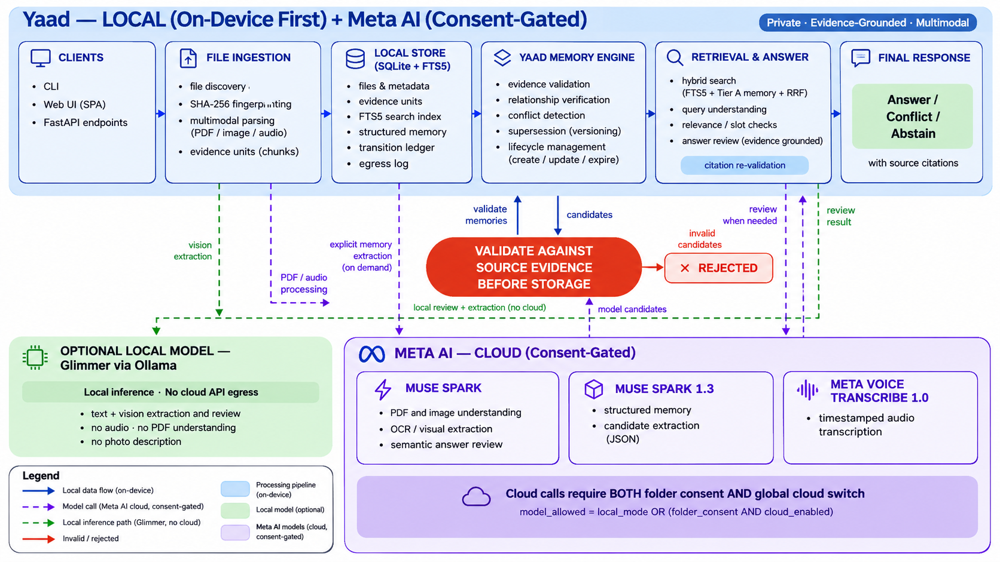

# Yaad architecture

Local-first memory engine: files stay on-device in SQLite; models are called
only through consent + spend gates, and deterministic validators always have
the final word. Principle: **Models Propose. Evidence Disposes.**

*(Committed artwork above. Editable programmatic variants:
`scripts/make_architecture_horizontal.py`, and the vertical
`architecture.png` (generated on demand, not committed) via
`scripts/make_architecture_diagram.py`.)*

## Components

| Area | Modules | Role |
|---|---|---|
| Interfaces | `yaad/cli.py`, `yaad/api/main.py`, `yaad/ui/` | Typer CLI, FastAPI backend, dependency-free web UI |
| Discovery + indexing | `yaad/scan/discover.py`, `yaad/scan/worker.py`, `yaad/scan/hashing.py` | Folder walk, SHA-256 fingerprinting, incremental index, per-file statuses |
| Extraction | `yaad/extract/pdf.py`, `text.py`, `audio.py` | Local PDF text layer, TXT/DOCX, audio prep (ffmpeg); model-assisted OCR, image understanding, transcription |
| LLM boundary | `yaad/llm/meta_client.py`, `local_client.py`, `meta_config.py`, `strict_schema.py` | Meta Model API client, Ollama local client, allowlisted models, strict JSON schemas |
| Memory engine | `yaad/memory/extract.py`, `records.py`, `relationships.py`, `lifecycle.py`, `ledger.py`, `auto.py` | Candidate extraction, validation, conflict/supersession/staleness rules, transitions, background learning |
| Retrieval + answers | `yaad/query/retrieve.py`, `hybrid.py`, `memory_answer.py`, `answer.py`, `pipeline.py`, `verify.py`, `photos.py` | FTS5 search, Tier A + RRF fusion, memory planning, staged answering, claim verification, photo search |
| Evidence + privacy | `yaad/evidence/ids.py`, `yaad/privacy/masking.py` | Stable evidence IDs, identifier redaction, injection screening + quarantine |
| Storage | `yaad/db.py` | SQLite: folders, files, units, `units_fts`, memory tables, photo data, `egress_log`, jobs |

## Data flow

**Index.** `add-folder` registers a path with a consent flag. `index` walks
new/changed files (SHA-256 + mtime), parses text locally, and — only when
`model_allowed = local_mode OR (folder_consent AND cloud_enabled)` — calls a
model for scanned-page OCR, image understanding, PDF understanding, or audio
transcription. Every file ends `indexed`, `partial`, `skipped`, or `failed`
with an explicit reason; every model call is receipted in `egress_log`.

**Learn.** After indexing (and after answers), background extraction proposes
memory candidates as strict JSON. Each candidate is mechanically validated
(`validate_candidate`): excerpts must occur in the cited unit text, unknown
evidence IDs are rejected, identity keys dedupe. Accepted records upsert;
rival values conflict (both preserved, never served as settled); replacements
link through validated supersession; transitions append to the ledger. A
manual pass is available via `POST /api/memory/extract` (default $0.25 cap).

**Ask.** `answer_question` runs a bounded multi-stage pipeline: query
understanding → retrieval (FTS5 + memory channel, RRF fusion) → evidence
classification → chronology/conflict analysis → candidate generation →
independent verification → final construction or abstention. Model stages are
opt-in per call, spend-gated, and schema-validated; deterministic validators
(citation existence, excerpt containment, numeric/date consistency,
chronology, injection markers) can only be confirmed or downgraded by the
model — never overridden. Statuses: `answered`, `conflict`, `ambiguous`,
`partial`, `not_found`, `unverified`, plus availability states.

## Storage

SQLite holds folders, files (path, SHA-256, kind, status), evidence units
with stable IDs and locators, the `units_fts` full-text index (kept in sync by
triggers; rebuild with `yaad rebuild-fts`), memory records with evidence
links, the transition ledger, photo descriptions, and the egress log.
Originals are never copied into the database.

## Model boundary

Cloud (Meta Model API, default `muse-spark-1.3`) handles PDF/image
understanding, OCR, structured extraction, photo comparison, and answer
review; `muse-voice-transcribe-1.0` handles audio. Local mode (Ollama,
default `muse-glimmer:30b`) serves text + vision extraction and review with
no cloud egress; audio, PDF understanding, and photo description fail there
with clear messages. No silent rerouting between providers, ever.
